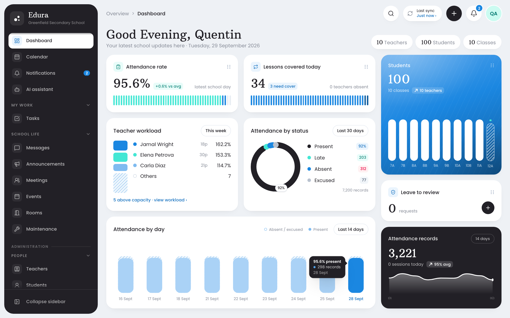
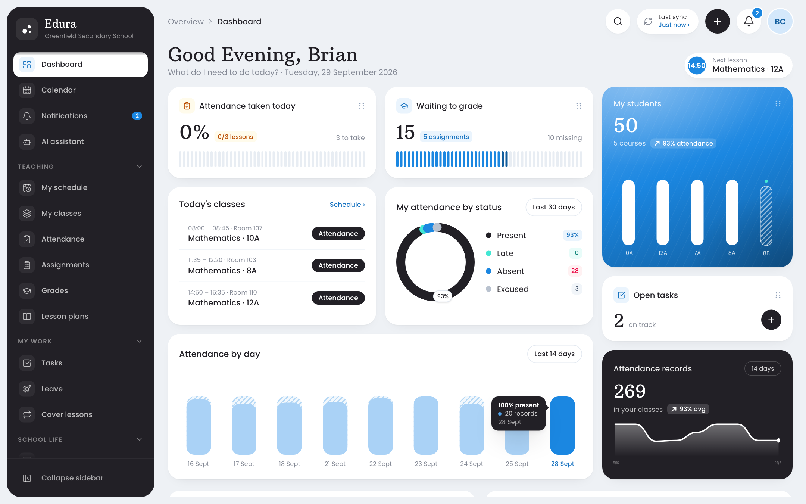
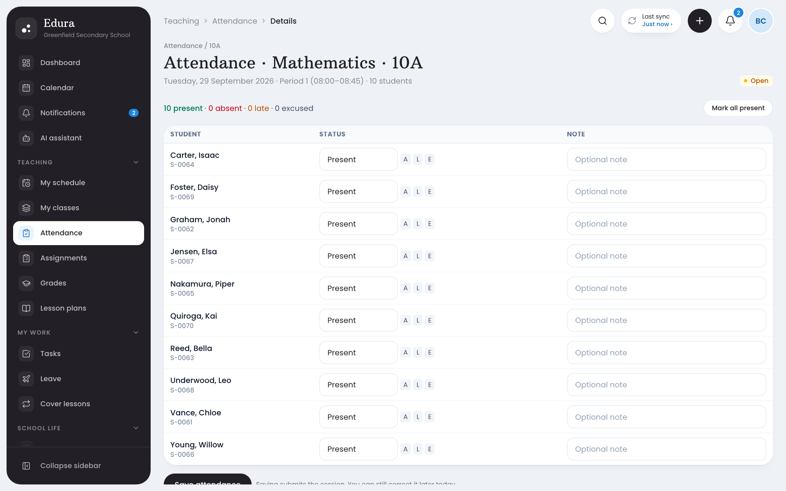
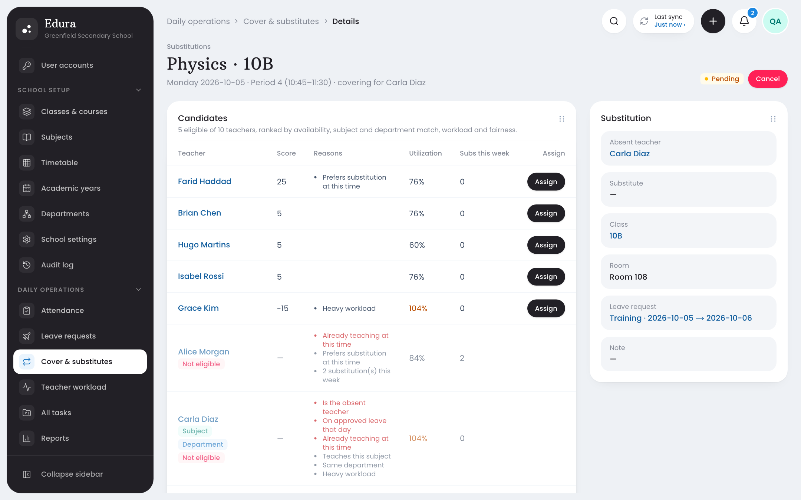
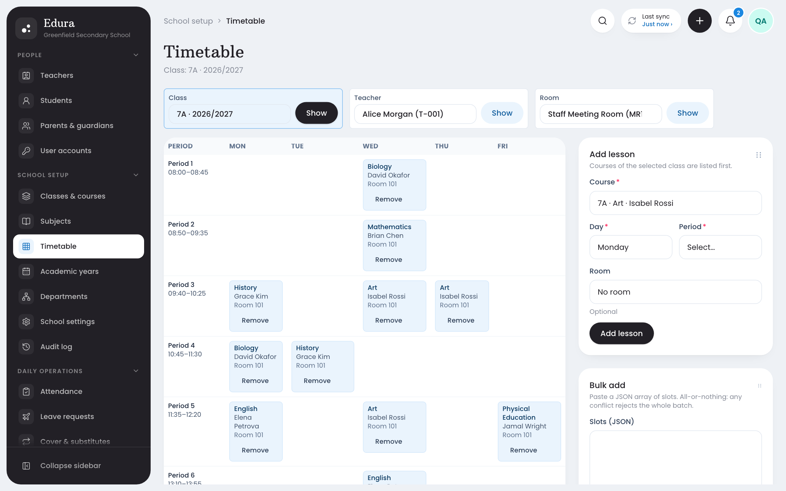
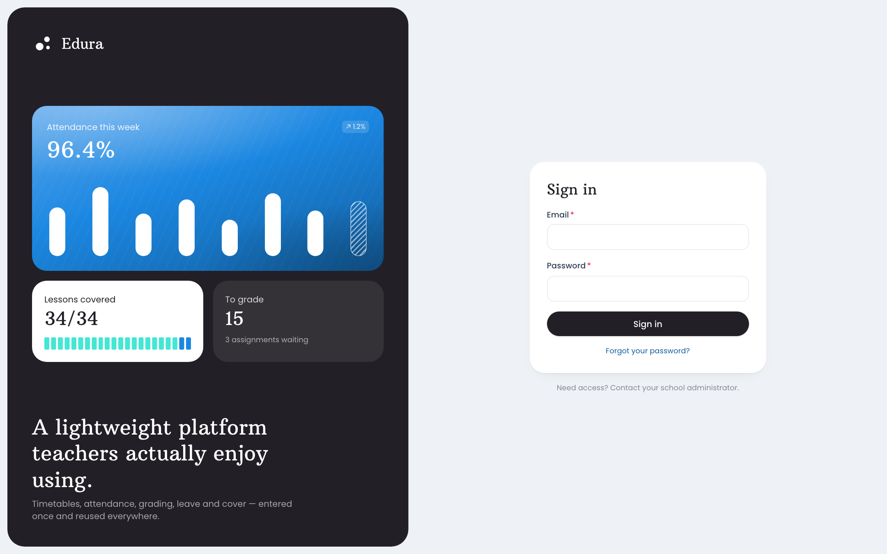
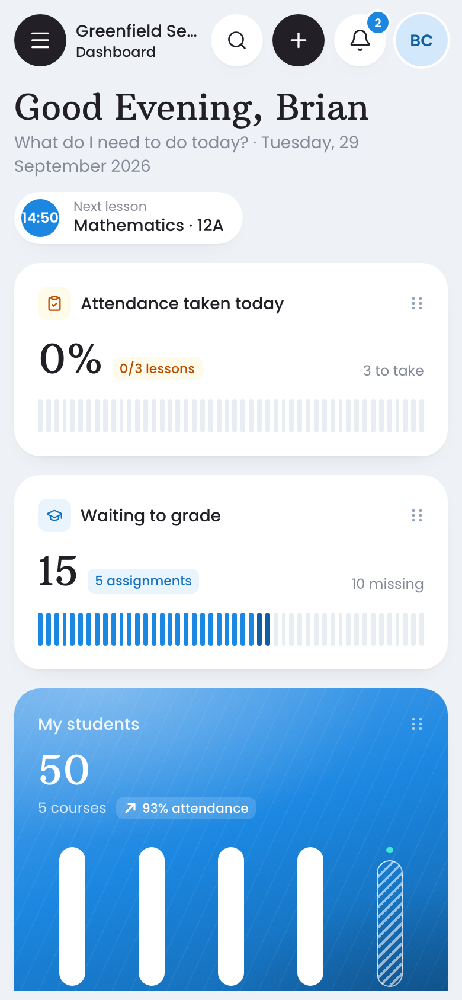

<p align="center">
  
</p>

<h1 align="center">Edura</h1>

<p align="center">
  The lightweight school platform that answers one question every morning:<br>
  <em>what needs doing today?</em>
</p>

<p align="center">
  
  
  
  
  
  
</p>

<p align="center">
  
</p>

Schools run on a hundred small questions. Who is teaching today? Which classes need cover? Who has been absent
three times this month? Whose grades are late? The answers usually live in spreadsheets, group chats and one
administrator's memory.

Edura puts them on one screen. Teachers enter attendance and grades once, and Edura reuses them everywhere:
parent notifications, statistics, cover planning and reports. It stays small enough for a school to run on a
single server without an IT department.

<p align="center">
  
</p>

## Highlights

- **A teacher's day on one page.** Today's lessons, the next class, attendance still to take, work waiting to
  be graded, tasks and meetings, all on the teacher's home screen.
- **Attendance in seconds.** Everyone is marked present by default. Tap the few exceptions and save. Guardians
  of absent students are notified automatically, and repeated absences raise an alert.
- **Leave to cover in minutes.** When leave is approved, Edura finds every affected lesson and ranks eligible
  substitutes by availability, subject, department and workload. Every reason is shown, and the administrator
  decides.
- **Workload you can see.** Teaching periods, cover, meetings and duties add up to one utilisation figure per
  teacher, so overload is spotted before it becomes burnout.
- **The right view for every role.** Administrators, principals, teachers, students and parents each get their
  own dashboard. Parents see only their children, and students see only themselves.
- **Clash-free timetables.** A teacher, class or room can never be double-booked. Conflicts are explained, not
  just rejected.
- **Helpful, careful AI.** Draft a lesson plan, reword a parent message or ask "which classes have attendance
  problems?". The assistant reads through the same permission checks as the rest of the app and never changes
  a record on its own.

<table>
  <tr>
    <td width="50%"></td>
    <td width="50%"></td>
  </tr>
  <tr>
    <td align="center"><b>Take attendance</b>: all present by default, tap the exceptions</td>
    <td align="center"><b>Find cover</b>: ranked substitutes with every reason shown</td>
  </tr>
  <tr>
    <td width="50%"></td>
    <td width="50%"></td>
  </tr>
  <tr>
    <td align="center"><b>Timetable</b>: teacher, class and room clashes are blocked</td>
    <td align="center"><b>Sign in</b>: accounts are created by the school</td>
  </tr>
</table>

<p align="center">
  
  <br><em>Works on phones and tablets, not just desktops.</em>
</p>

## Quick start

```bash
pnpm install && cp .env.example .env
docker compose up -d db
pnpm prisma migrate dev && pnpm db:seed
pnpm dev
```

Open http://localhost:3000 and sign in as `admin@edura.dev` or `brian.chen@edura.dev` with the password
`Password123!`. The seed builds a complete demo school: 10 teachers, 100 students, parents, a full timetable,
a month of attendance, assignments, grades, leave and cover.

Environment variables, every demo account, testing, scheduled jobs, deployment and troubleshooting are in
**[SETUP.md](SETUP.md)**.

**Requirements:** Node.js 20+, pnpm and Docker (for PostgreSQL).

## Who uses it for what

| Role | Home screen answers | Can do |
| --- | --- | --- |
| **Teacher** | What do I teach today, and what is waiting for me? | Take attendance, set and grade assignments, plan lessons, request leave, cover lessons |
| **School administrator** | Who is absent, what needs cover, what is overdue? | Manage people, classes and the timetable, review leave, assign substitutes, run reports |
| **Principal** | How is the school doing this month? | Everything an administrator can, plus a high-level overview |
| **Department head** | How is my department doing? | Teacher tools, plus department-wide tasks and reports |
| **Student** | What is due, and how am I doing? | See the timetable, submit assignments, view grades and events |
| **Parent** | How are my children doing? | Follow each child's attendance, grades and assignments; message teachers |

## How it works

1. **One application, one database.** Edura is a modular monolith: Next.js serves the pages and the JSON API,
   and each domain (attendance, grades, leave, substitution and so on) is a self-contained module with its own
   validation and business rules.
2. **Rules live on the server.** Double bookings, duplicate attendance, locked grades and cross-school access are
   refused by the business layer and backed by database constraints, whatever the screen allows.
3. **Automation is configuration.** Events such as "student absent", "leave approved" or "task overdue" run
   rules that notify people, create tasks or raise alerts. Every run is recorded.
4. **Permissions are simple.** A role grants permissions, the school scopes every query, and object-level
   checks cover the rest: a teacher sees their classes, and a parent sees their children.

Architecture, data model and the permission matrix are documented in [docs/](docs/architecture.md).

## Design principles

- **Enter once, reuse everywhere.** A mark in the register updates statistics, notifies parents and feeds
  reports. Nobody types it twice.
- **Useful before clever.** Every screen should save a teacher or administrator time on an ordinary Tuesday.
- **Transparent, never secret.** Suggestions such as substitute rankings show their reasons, and people make
  the decisions.
- **Small enough to run yourself.** One server and PostgreSQL. No queues, no microservices, no vendor lock-in.
- **Tested like it matters.** The full journey from school setup to substitute cover runs as an automated
  browser test, with unit and integration tests around every business rule.

## Roadmap

Built and available, switched off by default to keep the product simple (turn any of them on in
[`lib/features.ts`](lib/features.ts)):

- Report cards generated from submitted grades
- Professional development records and certification reminders
- Student support cases and discipline records
- An approvals inbox, an automation-rule editor and message templates

Ideas under consideration:

- Import students and timetables from CSV
- Printable class registers and PDF reports
- Parent–teacher meeting booking
- Calendar feeds (iCal) for teachers and families

## FAQ

**Does it need the AI assistant?**
No. Without an Anthropic API key the assistant is switched off and everything else works as normal.

**Can several schools share one installation?**
Yes. Every record belongs to a school, and users can only ever see their own school's data. A platform
administrator creates schools.

**Where do emails go?**
Configure SMTP to send real email. Without it, emails are written to the server log, which is handy in
development.

**How hard is it to host?**
It runs as one Docker container plus PostgreSQL, and migrations apply on start. See
[SETUP.md](SETUP.md#deployment).

**Can students or parents sign up themselves?**
No. Accounts are created by the school, and public sign-up is disabled.

## Contributing

Issues and pull requests are welcome. Start with [SETUP.md](SETUP.md) to get a local copy running, and read
[docs/conventions.md](docs/conventions.md) before adding a module. Keep business rules in `modules/`, keep route
handlers thin, and add tests alongside every rule you change.
